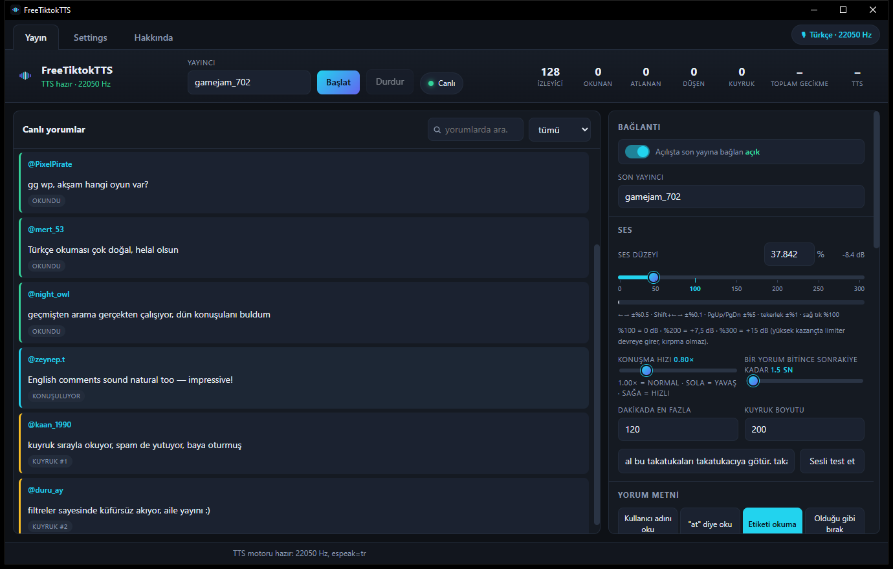
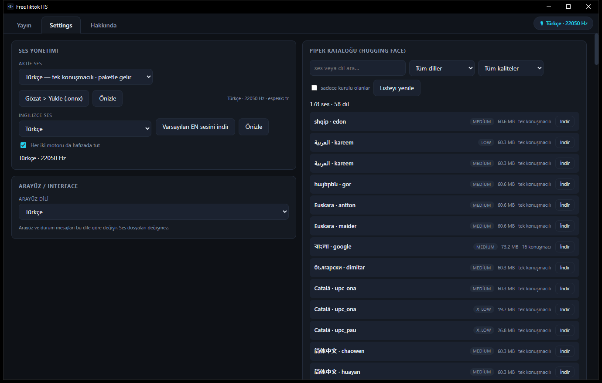
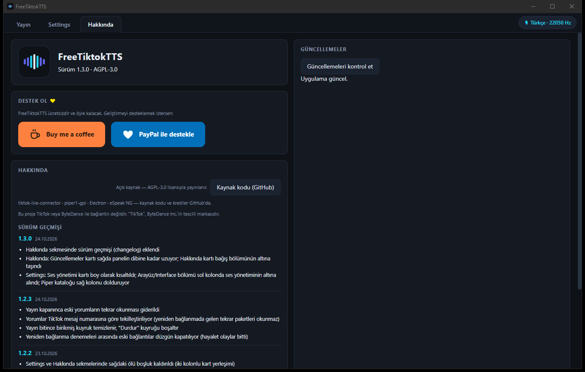

# FreeTiktokTTS

**Türkçe** | [English](README.en.md)

[](LICENSE)
[](https://github.com/cemo702/FreeTiktokTTS/releases)
[](https://buymeacoffee.com/cemo7028)

**TikTok canlı yayın yorumlarını, tamamı bilgisayarında çalışan yapay zekâ sesiyle (Piper TTS) okuyan ücretsiz masaüstü uygulaması.** İnternet üzerinden ses servisi kullanmaz; hiçbir yorum metni dışarı gitmez.

<p>
<em>Free TikTok live comment reader: reads live stream comments aloud with a fully local Piper TTS voice. No cloud, no external speech service — your data never leaves your machine.</em>
</p>

<p align="center">
  
</p>

## Ekran Görüntüleri

| Settings — sesler, filtreler, geçmiş | Hakkında — güncelleme ve destek |
|:---:|:---:|
|  |  |

> Görsellerdeki yorumlar tanıtım amaçlı örnek verilerdir.

## Özellikler

- 🔊 **Lokal TTS** — [Piper](https://github.com/OHF-Voice/piper1-gpl) motoru, tamamen çevrimdışı; her yorum anında seslendirilir — bulut servisleri kadar hızlı, ama ses asla bilgisayarından çıkmaz
- 🌍 **Otomatik dil seçimi** — İngilizce başlayan/2+ İngilizce kelime içeren yorumlar İngilizce sesle, diğerleri Türkçe sesle okunur; iki motor yan yana sıcak kalır
- 🎁 **Olay desteği** — hediye, abone ve like olayları okunabilir
- 🧹 **Gelişmiş filtreler** — küfür maskeleme (mask/\*\*\*/beep/atla), spam ve tekrar koruması, kullanıcı soğutması, kara liste/beyaz liste, regex kuralları, link/etiket temizleme
- 📋 **Kuyruk kontrolü** — sıralı okuma, temposu ayarlanabilir boşluklar, "hemen oku"/"atla" düğmeleri
- 💾 **Kalıcı yorum geçmişi** — tüm yorumlar (okunan + atlanan + sebepler) diske yazılır; Türkçe karakter duyarsız arama ile geriye dönük bulunur
- 🗣️ **Ses kataloğu** — Hugging Face'ten onlarca Piper sesi indirilebilir; İngilizce için ayrı ses seçilebilir
- 🔄 **Otomatik güncelleme** — yeni sürüm GitHub'a düşünce uygulama kendisi haber verir
- 🪶 **Hafif** — arayüz + motor ~500 MB RAM; geçmiş özelliği disk üstünde çalışır

## Kurulum

1. [**Releases**](https://github.com/cemo702/FreeTiktokTTS/releases) sayfasından en yeni `FreeTiktokTTS-Setup-x.y.z.exe` dosyasını indir
2. Kur — varsayılan ayarlarla (kullanıcı başına kurulum, yönetici hakkı gerekmez)
3. Uygulamayı aç, **Yayıncı** alanına TikTok kullanıcı adını ( @ olmadan ) yaz, **Başlat** de

> Windows ilk seferde SmartScreen uyarısı gösterebilir (imzasız kurulum): **"Daha fazla bilgi" → "Yine de çalıştır"** de. Uygulama açık kaynaklıdır; istersen [kaynak koddan kendin derleyebilirsin](#derleme-geliştiriciler-için).

Güncellemeler otomatik: uygulama açılışta kontrol eder, yeni sürüm varsa indirip yeniden başlatınca kurar.

## Sistem Gereksinimleri

- **İşletim sistemi:** Windows 10 / 11 (64-bit)
- **İşlemci:** herhangi bir modern çift çekirdek CPU yeterli — **GPU gerekmez**, seslendirme tamamen CPU'da çalışır
- **RAM:** 4 GB önerilir (uygulama + motor ~500 MB RAM kullanır)
- **Disk:** ~1 GB boş alan (uygulama ~600 MB + her ses modeli ~60 MB)
- **İnternet:** canlı yayın akışı için gerekir; **seslendirme tamamen yereldir** — yorum metni ve ses hiçbir bulut servisine gönderilmez

*Piper, onnxruntime'ın CPU çalışma zamanını kullanır; ekran kartı, CUDA veya özel sürücü gerekmez.*

## Derleme (geliştiriciler için)

```bash
git clone https://github.com/cemo702/FreeTiktokTTS.git
cd FreeTiktokTTS
npm install          # motor + ses modeli idempotent kurulur (setup-voice.mjs)
npm run setup:voice  # eksik kalmışsa tamamla (venv + model.onnx)
npm test             # 115+ test
npm run dist         # kurulum paketini üret (dist/)
```

Derleme gereksinimleri: Node.js 20+, Python 3.10+ (venv için), internet (ilk kurulumda model + pip paketleri).

## Yasal not

Bu proje **TikTok veya ByteDance ile bağlantılı değildir**. "TikTok", ByteDance Inc.'in tescilli markasıdır. Uygulama, TikTok'un yayın olaylarını okuyan açık kaynak [`tiktok-live-connector`](https://github.com/zerodytester/TikTok-Chat-Reader) kütüphanesini kullanır; kullanıcı adı dışında hiçbir veri toplanmaz veya gönderilmez.

## Krediler

- [`tiktok-live-connector`](https://github.com/zerodytester/TikTok-Chat-Reader) — TikTok LIVE olay akışı (AGPL-3.0)
- [`piper1-gpl`](https://github.com/OHF-Voice/piper1-gpl) — hızlı, lokal nöral TTS
- [99eren99/piper-turkish-tts](https://huggingface.co/99eren99/piper-turkish-tts) — paketli Türkçe ses modeli
- [RHVoice / eSpeak NG](https://github.com/espeak-ng/espeak-ng) — fonem üretimi
- [Electron](https://www.electronjs.org/) — masaüstü çatısı

## Destek ol 💛

Bu uygulama ücretsizdir ve öyle kalacak. Geliştirmeyi desteklemek istersen:

[](https://buymeacoffee.com/cemo7028)
[](https://www.paypal.com/donate/?hosted_button_id=L5CEV9BV2EBUG)

## Lisans

Bu proje [GNU Affero Genel Kamu Lisansı v3.0 (AGPL-3.0)](LICENSE) altında yayınlanır. Kısaca: kullan, değiştir, dağıt — ama türevi de aynı lisansla açık kalmak zorunda.

---
*Tam İngilizce sürüm: [README.en.md](README.en.md)*
